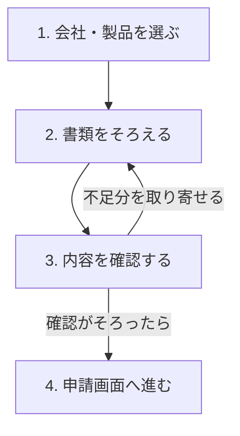

# PCA商品向け IT補助金申請アシスト機能 仕様案

作成日：2026年11月5日（日本時間）  
更新日：2026年11月7日（日本時間）  
版：0.2／業務・機能・基本設計案  
対象：補助金AIプラグインへの専用Skillと計算・検証機能の追加  
状態：仕様案。PCAとの要件合意、実装、配備、実案件での検証は未実施。

## 1. 企画の位置づけ

### 2026年11月7日の対象・完成条件の具体化

初期開発はIT補助金とPCA会計商品に限定する。PCAクラウド会計を最初の候補とし、対応するプラン・登録事業者・申請枠・公募回を明示する。下記の完成条件を優先し、他の補助金・PCA給与・販売管理等への展開は今回の完成条件に含めない。

**必要情報と正式な証憑がそろい、確認が完了した対応範囲内の案件について、利用者が公式画面で転記・選択・ファイル添付を順に行える状態まで準備する。**

- 画面順の転記ガイド：正式な項目名、コピーする値・文章、入力単位を対応づけ、説明や根拠はコピー対象から分離する。
- 選択ガイド：選択肢・チェック欄の回答案を示す。宣誓や本人の意思確認を自動で同意済みにしない。
- 添付ファイル対応表：アップロード先、正式なファイル名、資料の対象期間、形式、確認状態を対応づける。取得が必要な公的証明書をAIで代替生成しない。
- 作成する指定様式：実際の当年度様式に記入し、必要な形式を維持して出力する。Markdownの説明だけでは様式作成の完了としない。
- 担当別の配布：申請者用とPCA担当者用を分け、閲覧制限のある原本を一律に共有しない。
- 不足がある案件：未完成と表示し、必要な取得・確認作業を先に示す。条件・数値を推測して転記用の確定値にしない。

完成判定には、対象の公式画面と全項目・選択肢・添付先の照合、および担当者が出力物だけで転記・添付を進める操作検証を含める。利用者が新たに文章を考えたり再計算したりする必要が残る場合は、準備完了としない。本人認証・内容確認・宣誓・最終提出は本人の工程として残す。

実現性の見込みと実証済みの状態は区別する。現在は仕様段階であり、PCAの個別商品登録と実画面の対応確認、実案件の情報取扱条件は未完了。以下の通常枠・金額区分等は初期実装の推奨案であり、今回の対象限定だけをもってPCAとの合意済み範囲とは扱わない。

**PCA商品の導入相談を受け、申請企業・商品・公募条件・見積・計画数値を整理し、申請者とPCA担当者が確認して利用できる「申請準備パッケージ」を作成する。**

第一の目的は、PCAの補助金申請支援担当者が行う情報収集、確認、再質問、転記準備、修正確認の負担を減らすこと。次に、同じ機能をPCA販売パートナーと導入企業へ展開する。成果は担当者の作業時間と手戻りで評価する。

参照会話ではPCA会計を起点とした専用Skillと実演の構想が示されている。本仕様では、まず「PCAクラウド会計・通常枠」の申請準備を一通り扱い、共通設計を他のPCA商品・申請枠へ展開する。協業・事業移管・販売価格に関する合意成立は前提に置かない。

参照：[IT補助金適合性評価](chatgpt-conversation://6aec0107-de44-83ec-93ab-4a519ca3ccfe)。取得できた会議記録は途中で切れているため、未取得部分の予定・合意事項を本仕様の確定条件にしない。

## 2. 推奨する初期範囲

| 項目 | 初期仕様案 |
|---|---|
| 主利用者 | PCAの申請支援担当者。申請者の確認・回答を受けながら準備する |
| 最初の商品 | PCAクラウド会計。実際に対象とする提供プラン・登録ITツールはPCA確認後に限定 |
| 最初の申請者 | 国内の一般的な中小企業法人。個人事業主・特殊な法人形態は後続対応として案内 |
| 制度 | デジタル化・AI導入補助金2026。通称「IT補助金」「IT導入補助金」も入口で認識 |
| 初期の完全対応 | 通常枠・補助金申請額150万円未満・標準補助率の案件から開始 |
| 入口で比較する枠 | 通常枠／インボイス枠（インボイス対応類型）。適用可能性、追加条件、対応範囲を提示 |
| 初期の到達点 | 確認済み案件について、画面順の転記・選択ガイド、必要な指定様式、添付ファイル対応表を担当別に出力 |
| インターフェース | 既存プラグインの会話と文書出力。専用Web画面は初期の必須条件にしない |
| 後続拡張 | 通常枠の高額区分・補助率引上げ・過去受給案件、インボイス枠の申請準備、PCA給与・商魂・商管・PCA Arch等 |

通常枠を初期開発の軸とする理由は、資料収集・製品照合・数値計画・ドラフト・再検証を一つの案件で実証できるため。個別顧客への推奨枠は開発都合で固定しない。インボイス枠の方が検討に適する場合は、その理由と専用の確認先を示す。

高額区分、過去受給、補助率引上げ等を初期に完全実装しない場合でも、分岐の検出と担当者への引き継ぎは必須とする。「未対応」は「制度上の対象外」と区別する。対象額を小さく見せたり、過去受給を無視して初期対応範囲へ押し込めたりしない。

## 3. 公式情報の確認結果と適用方針

以下は2026年11月5日の確認結果。将来の案件へ固定知識として流用しない。

| 確認事項 | 仕様への反映 | 根拠 |
|---|---|---|
| 制度の正式名称はデジタル化・AI導入補助金2026 | 表示名と検索用の旧称を分ける | [中小企業庁の案内](https://mirasapo-plus.go.jp/infomation/31537/) |
| 公式配布ページは第7回公募以降と第6回までの公募要領を分けて掲載 | 年度・枠・公募回・適用版で制度を特定する | [資料ダウンロード](https://it-shien.smrj.go.jp/download/)、[第7回以降・通常枠公募要領](https://it-shien.smrj.go.jp/pdf/it2026_kaitei_koubo_tsujyo.pdf) |
| 第7次締切は通常枠・インボイス対応類型とも2026年12月1日17:00 | 初期実証の制度スナップショット候補。実利用時は最新日程を再取得 | [公式スケジュール](https://it-shien.smrj.go.jp/schedule/) |
| PCAはPCAクラウド／PCA Archについて通常枠とインボイス対応類型を案内 | 商品群の入口に利用。個別SKUの登録確認は別に行う | [PCA公式案内](https://pca.jp/area_top/itdonyu/index.html) |
| ITツールは事務局への登録・承認が必要 | 商品名の一致だけで申請対象としない | [ITツール登録手続き](https://it-shien.smrj.go.jp/itvendor/procedure/ittool/) |
| 申請者とIT導入支援事業者が役割を分担 | 入力案に公式画面の担当者を付ける。準備担当と提出権限を分ける | [公式手続きフロー](https://it-shien.smrj.go.jp/applicant/flow/) |

### 3.1 最新マニュアルに基づく補正

公式の[交付申請マニュアル](https://it-shien.smrj.go.jp/pdf/it2026_manual_kofu.pdf)は、今回取得したファイルでは**2026年11月2日改訂・106ページ**。印刷ページ13、16～17、34、51、53、62～66、69～73、85～88、106を中心に入力項目・担当・変更履歴を確認した。ページ53・88は図表も確認した。

- 通常枠の労働生産性計画は、申請者の「交付申請情報の入力③」にあり、計画は翌事業年度から3年間。
- 労働生産性の基準年度と給与計画の基準年度は、同じものとして自動転用しない。各項目の定義を保持する。
- 申請支援業務でPCA側が数値案を準備することと、公式画面での入力担当は区別する。

一方、[支援事業者向け概要](https://it-shien.smrj.go.jp/itvendor/procedure/ittool/application_for_issuance/)には5年間の計画と支援事業者による入力の記載がある。本仕様は、対象公募の要領と更新された画面別マニュアルを基準にする。実画面との一致はPCA担当者と別途確認し、未確認の画面項目・文字数制限を確定仕様として実装しない。

### 3.2 制度情報の採用順序

1. 対象公募に適用される交付規程・公募要領・改訂通知を確認する。
2. 手順と項目定義は同じ公募に対応する申請マニュアル・公式FAQで補完する。
3. 商品の登録は公式ITツール検索・PCAまたは登録支援事業者が示す登録資料で確認する。
4. PCAの商品説明は製品機能の根拠として使い、補助率・締切等の制度条件は事務局資料で確認する。

矛盾が残る場合は、出典・版・該当箇所を並べ、影響する判定を「要確認」にする。AIが一方を都合よく選んで判定を完了させない。

## 4. 利用者と役割

| 利用者 | 行うこと | AIが支援すること |
|---|---|---|
| 導入企業・申請者 | 自社情報・実績・計画の確認、必要な宣誓、本人認証、提出 | 不足情報の整理、入力案、数値の説明、提出前のチェック |
| PCA申請支援担当者 | 顧客への確認、商品・見積の確認、計画作成支援、担当工程の入力 | 顧客確認事項、商品対応表、計算、修正差分、申請者への引き継ぎ |
| 登録された販売パートナー | 自社の登録に基づく支援業務 | 当該事業者にひもづく登録ITツールの確認 |
| 制度・商品情報の管理担当 | 公式資料・製品登録・ルールの更新と承認 | 差分検出、影響する案件・テストの一覧 |
| 必要に応じた専門家 | 財務・労務・制度解釈・業務範囲等の個別判断 | 根拠と未解決事項をまとめた相談資料 |

販売店であることだけをIT導入支援事業者の資格とみなさない。PCA本体、コンソーシアム、構成員、販売店を区別し、案件に対してどの登録・権限を使用するかを確認する。

有償で他社の申請準備を受託する場合の業務範囲・契約・資格の整理は、提供前に運営者と法務担当が確認する。特定の士業資格だけで、本制度のあらゆる作成・提出業務を行えると想定しない。

## 5. 利用の流れ

### 担当者に見せる4ステップ

日々の複雑な業務で疲れていても、表示された操作を順に行えば準備が進むことを目標にする。制度やシステムの仕組みを学ぶ負担を減らし、「選ぶ・添付する・確認する・コピーする」を中心にする。4ステップは案内の区分であり、クリック数・質問数・所要時間・申請完了の保証ではない。

| ステップ | 担当者にお願いすること | 次へ進む条件 |
|---|---|---|
| 1. 会社・製品を選ぶ | 会社名を入力して候補を選び、導入製品・目的・時期などを順に選択・確認する | 会社が特定され、希望する導入内容と対象公募・対応範囲を整理できた。製品や枠を無断で変更しない |
| 2. 書類をそろえる | チェックリストの書類を添付する。手元にない資料は用意された依頼文で取り寄せる。必要な事前手続きも案内順に進める | 必要な書類と確認事項がそろった。返事待ちでも手元の資料の確認は進められるが、ステップ全体の完了とはしない |
| 3. 内容を確認する | 提示された値・文案・計画の前提を確認し、合っていれば次へ、違う部分は修正する | 必須情報・根拠・計算・商品登録・添付・画面対応と担当者レビューがそろった |
| 4. 申請画面へ進む | 案内順にコピー・選択・添付し、本人が認証・宣誓・最終確認・提出する。他者の担当入力は用意された文面で依頼する | 申請準備の完了と提出の完了を分ける。公式画面での提出結果を確認するまで申請済みにしない |

上表の完了条件と第4節の役割・権限は内部設計用。利用者の初回表示はステップ名と本人の行動だけにする。販売会社・社内・専門家への依頼も本人のタスクに統合し、AIの内部処理や役割分担の理解を求めない。公式画面の入力権限、担当別の出力、私有資料の共有制限は変更しない。交付後の導入・実績報告等は後続手続きとして適切な段階で案内する。

### 5.1 会話の進め方

- 初回は4ステップ程度の短い見通しの直後に、今する操作を一つ出す。会社名がなければ会社名の入力から始める。既知の会社・製品・資料は引き継ぎ、途中からなら現在地と次の操作だけを示す。初回から全確認事項や仕組みの説明を読ませない。
- 一回の操作は一つの作業単位とする。同じ見積から確認できる製品・金額・期間はまとめられるが、「4点」の下に多数の小問を並べない。対象年度・公募回・希望枠・申請額・過去受給・事前発注等の確認は必要な段階へ配置し、省略・推測しない。
- 企業名から公開情報を補完し、同名候補は正式名称・所在地を付けた選択肢から選んでもらう。選択肢と実取得した法人番号の対応を保持し、選択後は名称・番号・所在地を引き継ぐ。「該当する会社がない」、候補の続き、0件、取得失敗、UIが使えない場合は[共通の会社選択手順](../plugins/subsidy-ai/skills/company-research/references/company-selection.md)に従う。利用者の立場は、自社か顧客かが次の操作に影響する場面で確認する。原本・受領資料・既知情報にある値を再入力させない。公開情報と本人の申告は区別して記録する。
- 選べる項目はホストの適切な質問UIを使い、自由入力は会社名等の必要な部分に絞る。「未定」「手元にない」「あとで確認する」から該当する選択肢を用意する。未定は未確認のまま別の準備へ進め、資格要件や宣誓に自動同意しない。UIがない場合は短い入力依頼・番号付き選択肢にする。
- 書類収集の段階で、その時点で必要と分かった資料をチェックリストにする。正式名称・必要年度・取得先・次の操作を添え、一覧を参照できる状態で今取り組む資料の詳細だけを出す。追加条件による資料は条件付きとし、後から増える場合は理由を短く示す。ファイル添付非対応の質問UIへ添付を求めない。
- 販売会社・社内・専門家に頼む作業は、宛先の役割、必要資料、確認事項を含む依頼文を用意し、「この文面を送る」という担当者の操作にする。依頼文作成・送信・返答の状態を分け、明示的な送信指示なしに外部送信しない。返事待ちで進められない項目を残し、別の準備へ案内する。
- 内容確認では値・文章を提示してから「この内容で進む」「修正する」「あとで確認する」を選んでもらう。根拠・計算式・制度の詳細は必要時に参照できるようにする。矛盾、重要な不明点、本人が決める計画の前提は確認対象として表示する。
- 回答後は反映した内容と次の操作を短く示す。中断・再開時も既知情報から続け、確認待ちを完了扱いしない。4ステップを25%刻みの進捗や所要時間に変換しない。準備完了は「確認済みの内容を公式画面へ入力できる状態」とし、正式提出・交付決定と区別する。
- 会話が「PCAの操作方法」や「会社概要の転記」に変わった場合は、その依頼に合う既存機能へ移る。

#### 操作表示と実装範囲

主となる操作は一つとし、「確認」「処理」などの曖昧な表示より「この会社を選ぶ」「見積書を添付する」「依頼文をコピーする」など結果が分かる文言を使う。「あとで確認する」等の補助操作は別に設けられる。条件を満たせない操作には、理由と今できる代替操作を添える。

ここで挙げた操作名は表示仕様であり、専用ボタンを実装済みとするものではない。現時点ではホストが実際に提供する質問UI・添付操作とローカル出力の対応機能を使う。ボタンを表示する場合は、動作・反映結果・失敗時の案内を備える。会話中の角括弧だけの文字列をクリック可能と説明しない。自動保存・自動送信・公式申請への自動入力を、未接続のまま案内しない。正式様式等に未対応の作業が残る場合は、その作業に入る前に具体的な手順を示す。

### 5.2 案件の状態

`相談開始 → 条件整理 → 情報収集中 → 入力案作成 → 担当者確認中 → 転記準備完了`

どの状態からも「確認待ち」「再確認が必要」「今回の対応範囲外」に遷移できる。「転記準備完了」は、本機能の対応範囲について必要項目と確認がそろった状態であり、交付決定や採択を表さない。

制度の版、企業、商品、見積、財務値、計画値を変更した場合は、依存する計算・文章・チェック結果・確認記録を再確認対象とする。古い出力を黙って上書きせず、版番号と差分を残す。

## 6. 機能要件

P0＝架空データによる実証、P1＝限定した実案件での利用、P2＝商品・制度・運用の拡張。

| ID | 機能 | 入力・処理 | 出力・完了条件 | 優先 |
|---|---|---|---|---|
| F01 | 専用Skillへの誘導 | PCA商品とIT補助金の利用・準備意図を認識 | 専用手順を開始。一般相談・企業調査との誤選択も検証 | P0 |
| F02 | 公募の特定 | 年度、枠、締切回、申請予定日、適用資料を確認 | 公募条件・版・確認日・受付状況を表示 | P0 |
| F03 | 商品・支援事業者の照合 | 正式商品名、提供形態、プラン、登録番号、支援事業者を照合 | 確認済みの組合せ／候補複数／未確認を分離 | P0 |
| F04 | 企業の基本情報整理 | 法人番号・公的情報・申告情報を照合 | 出典付きの企業情報。古い値や食い違いを表示 | P0 |
| F05 | 申請条件の確認 | 規模、業種、資本関係、過去受給、事前手続き等 | 条件単位の一致・不一致・未確認・未対応 | P0 |
| F06 | 枠の比較 | 通常枠とインボイス対応類型の候補条件を比較 | 金額だけでなく必要機能・追加要件・準備負担を表示 | P0概要／P2全計算 |
| F07 | 資料からの項目抽出 | 見積、財務・労働時間の資料等から必要項目を抽出 | 値、期間、単位、資料位置、確認状態を保持 | P0架空／P1実資料 |
| F08 | 補助対象経費の計算 | 見積明細を登録区分・対象期間・税区分に対応づけ | 対象額、対象外額、補助金試算、支払総額 | P0標準／P2拡張 |
| F09 | 計画数値の計算 | 確認済み実績、利用者が説明できる改善策・前提を使用 | 生産性・成長率、必要な賃金計画、根拠と未達箇所 | P0標準／P2拡張 |
| F10 | 入力案の生成 | 申請項目定義と確認済みの企業・商品・計画情報を使用 | 項目順の回答案。各回答を根拠・数値版に接続 | P0 |
| F11 | 必要資料の確認 | 組織形態、申請区分、適用条件から必要資料を抽出 | 資料名、用途、取得担当、期限、確認状況 | P0 |
| F12 | 整合性検証 | 未入力、単位、年度、見積、登録、計画、文章を照合 | 指摘、重要度、修正対象、根拠、確認担当 | P0 |
| F13 | 差分更新・再検証 | 一つの条件変更から関連箇所を再計算・再生成 | 変更前後、影響範囲、確認のやり直し箇所 | P0 |
| F14 | パッケージ出力 | 確認状態と最新版を固定して出力 | 入力案、計算表、資料表、確認事項、根拠一覧 | P0 |
| F15 | 実案件のアクセス制御 | 利用者・企業・担当案件の権限を確認 | 他社・他担当へ漏れず、権限外の処理を拒否 | P1 |
| F16 | 申請後の支援 | 交付決定後の手続き・実績・効果報告を案内 | 初期は説明・引き継ぎ。実績報告作成は後続 | P2 |

## 7. PCA商品と登録ITツールの管理

### 7.1 商品名と申請対象を分ける

商品カタログは導入相談に、登録ITツール情報は申請条件の照合に使う。PCAブランドであるという理由だけで、対象商品、補助率、プロセス数、登録済みを確定しない。

登録情報は次の組合せで管理する。

`制度年度 × 登録IT導入支援事業者／構成員 × ITツール登録番号 × 登録版`

| 項目群 | 保持する情報 |
|---|---|
| 商品 | 正式名、別名、商品群、クラウド／サブスク／買切り等の提供形態、プラン、版 |
| 登録 | ITツール番号、支援事業者番号、コンソーシアム・構成員、登録状態、適用年度 |
| 機能 | 登録された業務プロセス、インボイス関連機能、対象区分、関連ツールとの組合せ |
| 価格・期間 | 登録上の価格条件、単位、契約期間、利用人数、オプション・役務の区分 |
| 根拠 | 公式検索・登録資料・PCA確認資料の参照先、確認日、確認者、有効範囲 |

同名商品でも販売経路・契約形態・プランが違う場合は候補を分ける。登録未確認の候補は提示できるが、確認済みとして補助金計算に使用しない。

### 7.2 見積との突き合わせ

- 明細ごとに登録ITツールとの対応、数量、単価、値引き、期間、消費税を保持する。
- クラウド本体、オプション、導入設定、データ移行、操作指導等を分け、登録された対象経費に該当するか個別に確認する。
- プロセス数・機能数はソフト本数と区別し、同じ登録プロセスの重複を除く。
- 数量・期間・年数を別項目で保持し、契約期間を数量と年数の両方へ二重計上しない。関連役務はサポート対象ITツールとの対応、登録価格、登録変更の審査状態も確認する。
- 既存契約の更新、追加ライセンス、置換え、他社製品混在等は専用条件を適用し、条件未実装なら照合を保留する。
- 実務用商品マスタを承認するまでは、架空登録番号に `DEMO` を付けたデモ専用データを使用する。本番マスタへ混入させない。

## 8. 収集する情報と申請項目

### 8.1 収集単位

| 分類 | 主な情報 | 主な提供・確認者 |
|---|---|---|
| 企業情報 | 法人番号、正式名称、所在地、組織形態、業種、設立日、資本金、規模 | 公的情報＋申請者 |
| 条件確認 | 資本関係、みなし同一法人、過去申請・交付決定、重複経費、事前発注の有無 | 申請者＋担当者 |
| 事前手続き | GビズIDプライムの取得状況、SECURITY ACTIONの宣言状況、必要な加点手続き | 申請者 |
| 導入内容 | 現在の処理、課題、対象業務、商品・プラン、利用者数、導入予定時期 | 申請者＋PCA |
| 見積 | 見積発行者、日付、版、明細、税・値引き、支払条件、対象期間 | PCA／販売パートナー |
| 財務・労働 | 決算期、必要な損益項目、総労働時間、計画の前提 | 申請者・経理担当 |
| 賃金 | 適用条件に必要な集計値、対象者の定義、基準期間、表明状況 | 申請者・労務担当 |
| 証憑 | 資料名、対象法人・期間、発行日、該当ページ・欄、確認状態 | 申請者＋権限を持つ確認者 |

GビズIDのパスワード、SMSコード、銀行ログイン情報は収集しない。役員・従業員の個人情報や連絡先は、当該工程で必要なものだけを扱い、初期実証では架空値とする。

### 8.2 申請項目定義の初期構成

下表は「項目群」の設計。実際の全設問・選択肢・入力制約を定義済みという意味ではない。実装着手時に対象分岐の項目台帳を完成させる。

| 項目群 | 公式マニュアルの参照箇所 | 公式画面の主担当 | AIの出力 |
|---|---|---|---|
| 基本情報・企業属性 | 45～50ページ | 申請者 | 公的情報との照合表・不足情報 |
| 法人財務情報 | 51ページ | 申請者 | 項目別の値・期間・根拠・単位 |
| 経営状況の設問 | 通常枠53ページ | 申請者 | 設問に対応した選択案・回答案・根拠 |
| 必要書類 | 16～32、58ページ | 申請者 | 条件別チェックリスト |
| ITツール・申請額 | 62～73ページの対象手順 | IT導入支援事業者 | 登録・見積対応表、申請額案 |
| 申請要件・賃金計画 | 85～87ページ | 申請者 | 条件別の確認・計画表 |
| 通常枠の労働生産性 | 88ページ | 申請者 | 基準年度と3年分の計画・検証 |
| 宣誓・本人認証・提出 | 93～97ページの対象手順 | 申請者 | 確認事項の案内。本人操作を残す |

上表の根拠：[2026年交付申請マニュアル](https://it-shien.smrj.go.jp/pdf/it2026_manual_kofu.pdf)。AIやPCA担当者による準備・レビューと、ポータルでの入力・提出権限を混同しない。

項目台帳には `項目ID、年度・枠・版、画面名、正式ラベル、型、必須条件、選択肢、文字数、単位、基準期間、入力担当、参照ページ、検証ルール` を持たせる。未確認の文字数・選択肢は未確定のままとし、架空の「公式入力欄」を作らない。

## 9. 判定・計算・文章生成

### 9.1 判定の表示

総合点だけで申請可否を表さず、次を分ける。

1. 事業目的とPCA商品の機能の適合。
2. 申請企業の制度条件との照合。
3. 商品登録・見積明細・対象経費との照合。
4. 資金、導入時期、資料準備、計画実現性の確認。

条件ごとの状態は「確認済み」「条件に一致しない」「追加確認が必要」「今回の機能では判定できない」「この案件には適用しない」。該当なしは理由と適用条件を確認した場合だけ付ける。公開情報が見つからないことを条件不一致としない。

必須条件の未確認や未実装が一つでも残れば、全面的な「申請可能」「転記準備完了」は返さない。確認済みの範囲と残作業は出力できる。

### 9.2 補助金・支払額の計算

計算は専用コードで行い、AIには結果の説明を担当させる。

1. 見積明細を登録ツールと費目へ対応づける。
2. 対象・対象外・未確認を分け、対象期間・値引き・税・数量を整える。
3. 適用する枠・区分・補助率・上下限・機能数・端数処理をルール版から取得する。
4. 区分別に計算し、適用下限・上限・申請額の条件を検証する。
5. 補助対象経費、対象外経費、消費税、申請予定額、実際の支払総額を分けて出す。

通常枠の標準補助率は1/2以内。補助率引上げの可否は専用要件を確認する。適用公募の根拠は[第7回以降の通常枠公募要領](https://it-shien.smrj.go.jp/pdf/it2026_kaitei_koubo_tsujyo.pdf)。上限額へ単純に切り詰めて要件を満たしたように扱わない。

インボイス枠を計算対象にする段階では、補助額の段階別補助率、機能要件、事業者区分、ハードウェアの別枠上限を実装する。「全部4/5」「全部2/3」といった一括計算は認めない。[第7回以降のインボイス対応類型公募要領](https://it-shien.smrj.go.jp/pdf/it2026_kaitei_koubo_invoice.pdf)

補助金受領前の支払と、受領後の実質負担を区別する。申請予定額を値引き額として表示しない。入金時期を推測して資金繰りを確定しない。

### 9.3 労働生産性と計画

基本式は `付加価値額 ÷ 年間総労働時間`。付加価値額は対象制度が定義する営業利益・人件費・減価償却費から構成する。計算の根拠は[通常枠公募要領](https://it-shien.smrj.go.jp/pdf/it2026_kaitei_koubo_tsujyo.pdf)の申請要件とする。

- 基準年度、各計画年度、総労働時間の定義を値と一緒に保持する。
- 1年後と3年間の年平均成長率を別々に検証する。基準となる実績年度と、公式計算上の期間数を別項目にし、暦年の差を無条件に指数へ使わない。
- 成長率の基本式は `((計画時の生産性 ÷ 基準の生産性)^(1/n) - 1) × 100` とし、`n` は対象公募が定める計算期間とする。公式計算結果と突き合わせ、丸め桁・比較前後の端数処理を項目台帳に明記する。
- 人件費、給与支給総額、1人当たり給与支給総額を別項目にする。対象者・費目の定義が違う値を転用しない。
- 基準値がゼロ・負、労働時間がゼロ、短い決算期間、特殊な組織形態等は専用処理へ送る。未実装なら計算不能の理由を返す。
- 過去受給によって目標等が変わる可能性を確認し、未確認のまま標準条件を適用しない。

計画は「現在の業務量・作業時間 → 導入機能 → 削減できる作業 → 費用・労働時間・利益への影響」という説明を残す。削減時間を別業務へ振り向けるだけの場合、企業全体の総労働時間や人件費が同じ割合で減るとは扱わない。同じ改善効果を利益増加と費用減少へ二重計上しない。

必要な改善水準の逆算は参考値として示せるが、実績を変更したり、目標達成のためだけに売上・利益・労働時間を自動調整したりしない。利用者が前提を説明・確認した計画だけを入力案へ採用する。

### 9.4 文章の作り方

各回答は、申請企業の課題、確認した商品機能、導入後の業務、確認済みの計画数値につなげる。選択式設問に対しては選択候補と理由を示し、長文を代わりに作らない。自由記述欄が確認できた項目のみ、その形式に合わせる。

導入目的や改善施策の説明文は、公式転記項目と「社内検討用の補足」を区別する。未確認の実績、認定、取引先、商品機能、表明済みの宣誓を生成しない。

## 10. 申請準備パッケージ

| 成果物 | 内容 | 初期形式 |
|---|---|---|
| 案件サマリー | 企業、商品、公募、担当、検討状況、重要な未確認事項 | 会話・Markdown |
| 申請入力案 | 公式項目順の値・回答案・担当・根拠・確認状態 | Markdown／表計算へ貼付可能な表 |
| 見積・補助金計算表 | 明細区分、対象額、税、補助金試算、支払額、適用ルール | 表＋機械可読JSON |
| 計画数値表 | 基準年度、計画年度、実績／仮定、計算式、改善根拠 | 表＋機械可読JSON |
| 必要資料一覧 | 条件別の資料、対象期間、取得・確認担当、進捗 | Markdown |
| チェック結果 | 未確認、不一致、矛盾、期限、重要度、修正方法 | Markdown |
| 引き継ぎメモ | 申請者が行うこと、PCAが行うこと、相談先への質問 | コピーできる文面 |
| 根拠・変更履歴 | 公式資料版、商品登録版、見積版、入力版、計算版、変更差分 | Markdown／JSON |

すべての出力に、デモ／実案件、作成日時、対象公募、入力版、ルール版、確認状態を付ける。不足がある場合も作成できるが、表紙と該当項目に「未完成・確認事項あり」を表示する。

Word・Excel・PDFの体裁調整は、既存ホストで利用できる文書作成機能を用いる後続の出力形式。初期機能の完成条件を特定のファイル形式に依存させない。CSVを出す場合は数式として解釈されるセルの無害化、機密列の除外を行う。

### 10.1 会話表示の例

以下は文面の見本であり、実際の判定・送信・画面機能の実行結果ではない。入力欄や選択肢は利用可能なホストUIで提示する。

**初回：**

> 申請まで、順番に進めていきましょう。
>
> **① 会社・製品を選ぶ → ② 書類をそろえる → ③ 内容を確認する → ④ 申請画面へ進む**
>
> まずは、申請する会社名を教えてください。

**見積書が手元にない場合：**

> **ステップ2：書類をそろえる**
>
> 販売会社に、次の文面を送ってください。
>
> 「補助金申請の準備を進めています。ご提案の会計ソフトについて、正式な製品・プラン名、利用人数、契約期間、費用内訳が分かる見積書と、対応するITツール・支援事業者の登録情報をご案内ください。」
>
> 返事を待つ間に、手元の書類の確認を進められます。

**内容確認：**

> **ステップ3：内容を確認する**
>
> 見積書から読み取った製品名・利用人数・契約期間・金額を表示します。内容をご確認ください。

確認対象の実際の値を表示したうえで、「この内容で進む／修正する／あとで確認する」を選べるようにする。読み取った値を表示せず確認済みにしない。本人が判断する計画の前提や重大な不一致は、この確認画面に残す。

進捗を割合で示す場合、分母はその案件に適用される必須項目だけにする。未確認の項目を分母から外して完成度を高く見せない。

## 11. 既存プラグインへの組込み

### 11.1 現在のソースで確認した基盤

| 既存要素 | 活用方針 | 限界・追加要件 |
|---|---|---|
| 国税庁・法人情報の照会 | 企業の正式名称・所在地等の補完 | 非公開の財務・現況は取得済みとしない |
| Jグランツ検索・詳細 | 制度候補、公開条件、資料情報の補助 | ITツール登録・全申請要件を網羅する基盤とは扱わない |
| 資本関係照合・みなし大企業評価 | 確認された公開資本関係を再利用 | 対象制度の基準と企業の現況は別途確認 |
| 公式資料ナビ | 公募別の出典管理に再利用を検討 | 配備・有効化・登録内容は別途確認 |
| 一般補助金相談Skill | 一般相談を継続 | PCA専用処理の開始条件・戻り先を追加 |
| company-research Skill | 企業情報のみの依頼で使用 | PCAの申請へ強制誘導しない |
| 公開情報キャッシュ | 公式制度・公開商品情報に限定して利用 | 案件・決算・見積・ドラフトを格納しない |

調査対象はローカルの `package.json`（0.13.0）、`src/index.ts`、`PRIVACY.md`、プラグインREADME、既存Skill。稼働中サーバーの全機能・導入済みパッケージは今回検証していない。

### 11.2 追加するSkill

配置案：`plugins/subsidy-ai/skills/pca-it-grant-application/SKILL.md`。

起動対象は、PCA商品導入に伴うIT補助金の適合確認、申請準備、必要資料、計画数値、入力案、修正・再検証。「PCA」または「補助金」の単語があるだけでは起動しない。商品操作の質問、採用研修助成金、企業情報だけの依頼は対象外。

Skillは会話の進行、資料の読み取り、質問、文章生成を担当する。制度条件・商品登録・数値の検証は専用処理へ委ねる。自然言語によるSkillの選択だけで正しく分岐したと保証せず、対象ホスト上で正例・誤選択例を検証する。

計算機能が利用できない場合、資料整理と条件付きの説明は続けられるが、「専用ロジックで検算済み」とは表示しない。

### 11.3 新規の処理境界

以下は実装候補名。既存の公開ツールとして存在するものではない。

| 処理／候補ツール | 主な入力 | 主な出力 | データの扱い |
|---|---|---|---|
| `get_pca_it_grant_context` | 年度・枠・公募回 | 適用資料、承認済みルール、項目定義、対応範囲 | 公開情報のみ |
| `resolve_pca_it_tool` | 商品・プラン・登録事業者・年度 | 登録候補、機能、関連区分、根拠 | 公開済み／提供許可済みマスタ |
| `evaluate_pca_it_grant_case` | 構造化した必要項目、見積、計画、ルール版 | 条件照合、金額・計画計算、不足項目 | P0架空データ。P1は認証済みの非保存処理 |
| `validate_pca_it_grant_draft` | 構造化ドラフト、根拠参照、入力・計算の版 | 項目充足、整合性、確認状態、差分 | P0架空データ。P1は認証済みの非保存処理 |

専用処理は原本PDF・画像・会話全文を要求せず、計算・照合に必要な構造化データを受け取る。公的APIへの検索には法人識別情報等の必要最小限のみを渡す。

P0では専用コードをローカル実行して実証できる。P1で遠隔実行する場合は認証・組織権限・入力削減・ログ制御を実装した経路を使用する。現在の公開MCPに非公開データ用の引数だけを追加して運用を開始しない。

### 11.4 実装配置案

- `src/pcaItGrant/`：制度・商品マスタ参照、入力型、計算、検証。
- `config/pca-it-grant/`：公開可能な承認済みのルール・項目定義。秘密・企業別データは含めない。
- `test/fixtures/pca-it-grant/`：架空案件、期待値、誤入力・例外シナリオ。
- 既存Skillの説明・プラグインの表示情報：専用Skillの追加に合わせて調整。

公開情報管理の既存テーブルを再利用できるかは実装時に確認する。実案件の永続保存を初期の必須条件にせず、企業別データを既存の公開情報DBへ混在させない。

## 12. データ・版・ルール管理

| データ | 必須の管理情報 |
|---|---|
| 公募 | 制度ID、年度、枠・類型、公募回、締切日時・タイムゾーン、適用ルール版 |
| 根拠資料 | 発行主体、URL、名称、資料版、取得日時、内容ハッシュ、適用範囲、該当箇所 |
| ルール | ルールID、根拠、入力項目、条件、計算方法、端数処理、適用日・公募回、確認者 |
| 項目値 | 値、型、単位、対象期間、出典種別、根拠位置、抽出／申告／確認済みの区別 |
| 計算結果 | 入力版・ハッシュ、計算エンジン版、ルール版、結果、未計算理由 |
| ドラフト | 案件ID、版、項目ID、回答、根拠参照、仮定、確認者、確認日時 |
| 指摘 | ルールID、対象項目、状態、重要度、根拠、不足情報、解消担当 |

案件IDは製品内の識別子とし、公式の交付申請番号と区別する。準備段階の「申請予定の公募回」と、公式画面で割り当てられた公募回も別項目にする。両者が異なったら適用ルールを再確認する。所属組織・案件へのアクセス権は認証情報から決め、利用者が入力した組織IDだけで閲覧権限を付与しない。

ルールの公開手順は `公式情報の取得 → 版・適用範囲の確認 → 差分確認 → 計算・境界値検証 → 担当者承認 → 有効化` とする。更新内容をAIだけで自動承認しない。

同じURLのPDFが差し替わる場合も検出する。旧版案件を再現できるよう版を保持し、最新版に切り替える際は変更点と影響する判定を提示する。将来年度の公募が未発表なら、当年度の条件を翌年度として扱わない。

案件の開始時と最終出力前に、受付状況・適用資料・商品登録の有効性を再確認する。取得失敗や情報の有効期限超過では、保存済みの情報と確認日を表示して資料整理を続けられるが、最新条件の確認済み表示は付けない。

## 13. 非公開情報を扱うための条件

現行の[プライバシーポリシー](../PRIVACY.md)は、非公開の決算書・賃金台帳等の入力を想定せず、企業別の評価・事業計画・非公開資料本文を保存しない設計である。**今回の申請支援はデータ取扱範囲を広げる機能なので、専用Skillの追加だけでは実案件提供を完了できない。**

### 13.1 初期実証

- 架空企業・架空財務・架空見積を使用する。
- 実企業名を消しただけの資料は、自動的に安全な架空データとして扱わない。
- 実在する登録情報と架空の登録情報を明示的に分ける。
- デモ結果・資料に「架空データ・申請には使用不可」を表示する。

### 13.2 実案件での利用開始前

1. 申請者、PCA、販売パートナー、サービス運営者の取扱範囲を定め、規約・プライバシー表示・必要な契約を更新する。
2. チャットホスト、資料解析、計算サーバー、保存先ごとの送信内容・保持方針を明示する。「MCPで保存しない」を「どこにもデータが残らない」と説明しない。
3. 非公開情報を処理する経路の認証と案件単位のアクセス制御を検証する。
4. 公開キャッシュと案件データを分離する。ログ、例外、計測イベントに決算・賃金・見積の本文を出さない。
5. 原本・抽出値・生成物・バックアップそれぞれの保管先、保存期間、削除方法、案件終了時の扱いを決める。未決定のまま実案件を受け付けない。
6. 初期は申請者ごとの従業員名簿を収集せず、必要な集計値を受領する。証憑の確認権限が必要な場合は人間の担当へ引き継ぐ。
7. 原本やWeb資料内の文章を、AIの実行命令として扱わない。文書からの外部送信・権限変更要求を実行しない。
8. ダウンロードする案件資料は権限と有効期限を限定する。共有リンクの公開やPCAへの送信は利用者の明示操作・依頼に基づく。

公式ポータルで支援事業者が閲覧できない資料もあるため、本機能を通じてPCA担当者へ一律に共有しない。原本の閲覧権限と、必要な集計値・確認済み結果の共有権限を分ける。[申請マニュアル64ページ](https://it-shien.smrj.go.jp/pdf/it2026_manual_kofu.pdf)

## 14. 初期対象外

- 公式ポータルへの自動ログイン、本人認証、宣誓、代理提出。
- 採択・受給の保証、企業ごとの採択確率の提示。
- 対象となる全PCA製品・全販売事業者・全申請枠への対応。
- 公開情報だけでの財務・賃金・資本関係の完全確認。
- PCA会計等からの常時自動データ取得。将来のAPI連携は権限・提供仕様を確認して別途設計。
- 実績報告・効果報告の全工程、交付後の契約・購入・振込処理。
- 共同購買、車両購入、研修助成金、料金請求・成功報酬管理。

初期対象外でも、申請前の契約・発注・支払、事後の報告義務等は検討に必要な範囲で案内する。交付決定後に実施する手続きの根拠は[公式案内](https://it-shien.smrj.go.jp/aftergrantdecision/measures/)を参照する。

## 15. 実証シナリオと受入条件

### 15.1 PCA向け実演

架空の中小企業法人がPCAクラウド会計の導入を検討する例を使う。登録番号・費用・財務数値はデモ用と明示する。

1. 自然文の相談からPCA専用手順へ入る。
2. 準備済みの架空企業資料・見積を読み、根拠付きで入力項目を整理する。
3. 不足した年間総労働時間等を尋ね、入力案と計算結果を出す。
4. わざと登録プランの食い違い・単位違い等を含め、指摘できることを示す。
5. その場で計画の労働時間を変更し、計算・文章・確認状態が連動して更新されることを示す。
6. 申請者用とPCA用の準備資料を出す。

実演は事前に整えた入力を使う短時間の紹介と、準備から通した検証を分ける。実演時間を申請1件の総作業時間として報告しない。

### 15.2 必須検証ケース

| No. | 条件 | 合格する挙動 |
|---|---|---|
| T01 | PCA会計の補助金準備を依頼 | 本人の操作を4段階程度で短く示し、会社名未取得なら入力を一つ求める。役割別の表・AIの作業説明・初回の大量質問を出さず、利用できる質問UIで始める。既知情報があれば次の不足へ進む |
| T02 | PCAの操作質問／会社概要のみ | 申請ワークフローへ誤誘導しない |
| T03 | 同名法人が複数／該当なし／続きあり | 正式名称・所在地付きの選択UIを出し、選択された候補の実取得法人番号を引き継ぐ。再入力や再確認だけの往復を求めない。該当なし・候補の続きから再検索でき、取得失敗と0件を区別する。UIがなければ番号回答に切り替え、無回答や既定選択では確定しない |
| T04 | 商品名のみ、登録番号なし | 対象製品確定・登録済み表示をしない |
| T05 | 別の支援事業者の同名商品 | 登録の組合せ不一致を検出 |
| T06 | 複数ソフトに同じ業務プロセス | 重複計上せず、必要数との照合を行う |
| T07 | 第6回用ルールで第7回を計算 | 適用版不一致として計算・完了表示を止める |
| T08 | 期限後／翌年度未発表 | 申請受付中とせず、準備可能な範囲を説明 |
| T09 | 財務値の千円・円混在／期間違い | 数値を確定せず根拠確認を求める |
| T10 | 総労働時間と1人平均時間の混同 | 別項目として検出し、誤計算しない |
| T11 | 生産性と賃金計画の基準年度が異なる | 各項目の基準を保持し、同一年度へ自動統一しない |
| T12 | 過去受給・高額区分・補助率引上げ | 専用条件または未対応への引き継ぎを行う |
| T13 | 基準値がゼロ・負／労働時間ゼロ | 不正な成長率や無限値を出さない |
| T14 | 上下限・機能数・端数の境界値 | 承認済みの公式条件と期待値に一致 |
| T15 | 交付決定前の発注・支払 | 該当事実と根拠を示し、要件一致として扱わない |
| T16 | 生成文の数字と計算表が違う | 当該回答を未確認に戻し、差分を示す |
| T17 | 見積・商品・計画値を変更 | 関連箇所と承認状態だけを適切に更新 |
| T18 | 必須資料が未確認 | 完了割合を水増しせず、転記準備完了を禁止 |
| T19 | 非公開資料内の命令／別案件へのアクセス | 命令を実行せず、権限外のデータを返さない |
| T20 | 情報取得・計算ツールが利用不可 | 取得・検算済みを装わず、継続可能な資料整理と未確認事項を返す |
| T21 | ステップ2で「見積書が手元にない」 | 宛先の役割と必要な項目を含む依頼文を提示する。送信指示がなければ送信せず、未受領を残して別の準備へ進める |
| T22 | 製品や時期について「未定」「あとで確認する」 | 未確認として保持し、既定値で確定しない。独立した準備を進める一方、必須確認が残れば転記準備完了にしない |
| T23 | 見積を添付済み／途中から再開 | 読取り済みの製品・金額・期間等を再入力させず、値を提示して確認を受ける。現在地と次の操作から再開する |
| T24 | 質問UI・添付・コピーボタンの一部が利用不可 | 実際に使える操作または短いテキスト回答へ切り替える。動かないボタン・自動保存・自動送信を提供済みと説明しない |
| T25 | 内容確認に矛盾・本人が決める計画の前提が残る | 重要な未確認点を詳細欄へ隠さず提示する。段階を進める選択だけで原本照合・宣誓・最終提出を完了扱いにしない |
| T26 | 支援担当者が顧客の申請を準備 | 顧客への依頼を自分の作業として案内する。本人限定の入力・宣誓・提出や申請者限定資料を支援担当者へ移さない |

T06・T14には、関連役務と本体ツールの対応不一致、契約期間の二重計上、登録変更の審査中、値引き後価格の扱いも含める。

T01・T21〜T26は会話・操作の確認基準。文面やソースの確認だけで合格とせず、対象ホストで実際の回答・操作・待ち状態・再開を確認して結果を記録する。今回の案内変更はソースへの反映であり、配布版への反映、ホスト上での通し試験、公式画面の操作受入（A15）の完了を意味しない。

### 15.3 リリース判定

- 対応範囲の必須項目と必須条件を台帳化し、未実装の条件を一覧に残す。台帳未完成を「全項目対応」としない。
- 対応範囲の計算期待値と境界値テストは全件一致。採否を左右する見逃し・捏造・他社データ漏えいは0件を必須とする。
- すべての生成した実績値・商品機能・制度条件は根拠を持ち、仮定は明示する。
- 数値変更後の旧計算・旧文章・旧確認状態が残らないことを確認する。
- スキル選択、ツール利用、ファイル出力を実際の対象ホストで通して確認する。ローカルテストだけで利用可能としない。
- P1の前に第13節の取扱条件と、申請者・PCA担当者による一連の操作確認を完了する。

## 16. 効果測定

最初は匿名化手順を確認した過去案件または利用同意のある少数案件で、従来作業と比較する。件数や削減率は実績取得前に成果として示さない。

| 指標 | 測り方 |
|---|---|
| 人手の総作業時間 | 情報整理、顧客確認、数値作成、レビュー、転記準備の合計。AI待ち時間は別計測 |
| 確認の往復回数 | 申請者への追加質問・資料差し替えの回数 |
| 項目充足率 | 適用する必須項目に対する確認済み項目。未適用理由を記録 |
| 修正件数・修正時間 | 出典不足、事実誤り、数値、表現を分けて集計 |
| 見逃し・誤警告 | 担当者が見つけた重要な不足と、不要な指摘 |
| 継続利用意向 | PCA担当者が継続利用したい工程と理由 |

初期の事業評価目標案は「同程度の案件で、人手の申請準備時間を30%以上短縮」。これは仮の目標であり、品質条件を満たしたうえでPCAと基準・対象件数を決める。採択率は外部要因が大きく、初期の品質評価を代替しない。

## 17. 開発の進め方

| 段階 | 作業 | 完了時の成果 |
|---|---|---|
| A：仕様確定 | 対象プラン・登録事業者・通常枠の対応分岐、項目台帳、制度版を確定 | PCA確認済みの対象範囲・ルール・入力項目 |
| B：実証実装 | 専用Skill、架空案件、商品照合、計算、入力案、検証、出力 | P0の一連の実演と検証結果 |
| C：実案件準備 | 取扱契約・表示、認証、データ境界、アクセス、ログ、保存・削除を整備 | P1利用開始条件の確認記録 |
| D：限定実証 | PCA担当者と申請者が実案件を確認し、修正時間と手戻りを計測 | 実用化判断用の結果・残課題 |
| E：展開 | 対象商品・申請区分・インボイス枠・販売パートナーへ拡張 | 対応マトリクスを増やした版 |

Aの未確定事項があっても架空データによるBの共通部分は進められる。完成予定日・費用は、対象分岐と既存出力手段の確認後に見積もる。過去会話に出た面談日を開発納期の確約として扱わない。

## 18. PCAへ確認する事項

| 優先 | 確認すること | 必要な理由 |
|---|---|---|
| 最優先 | 最初に扱う商品・プランと、その登録ITツール・登録事業者 | 申請対象を商品名から推測しないため |
| 最優先 | 実際の担当分担と、負担が大きい上位3工程 | 効果の高い機能へ初期開発を集中するため |
| 最優先 | 通常枠／インボイス枠の案件比率と、初期実証対象 | 開発順と実務の需要を整合させるため |
| 高 | 現在使うヒアリング票・見積明細・チェックリスト | 既存業務へそのまま組み込める出力にするため |
| 高 | 提供可能な過去案件と、匿名化・利用条件 | 抽出・検証・工数を実測するため |
| 高 | 対象ホスト、利用人数、利用者の権限・資料共有方法 | P1の実装・契約・保存設計を定めるため |
| 高 | 最新の公式画面と項目台帳の照合担当 | 文字数・選択肢・担当工程を確定するため |
| 展開前 | 商品登録・制度変更の更新責任者 | 更新が止まった機能を提供し続けないため |

これらは仕様案を検討するための確認事項であり、現時点でPCAの承認・資料提供が完了したという意味ではない。

## 19. 参照資料と確認範囲

| 資料 | 使用した範囲・注意 |
|---|---|
| [公式資料一覧](https://it-shien.smrj.go.jp/download/) | 第7回以降／第6回までの版の区分と配布先を確認 |
| [通常枠・第7回以降の公募要領](https://it-shien.smrj.go.jp/pdf/it2026_kaitei_koubo_tsujyo.pdf) | 2026年10月9日作成版。適用版、経費・計画の基本条件を確認。全条項の実装台帳化は未実施 |
| [インボイス対応類型・第7回以降の公募要領](https://it-shien.smrj.go.jp/pdf/it2026_kaitei_koubo_invoice.pdf) | 枠の基本構造を確認。専用計算・全分岐の定義は後続 |
| [交付申請マニュアル](https://it-shien.smrj.go.jp/pdf/it2026_manual_kofu.pdf) | 2026年11月2日改訂版を取得。対象箇所の本文と生産性表の図を確認。実ポータルでの照合は未実施 |
| [公式スケジュール](https://it-shien.smrj.go.jp/schedule/) | 確認時点の公募日程。随時更新されるため固定しない |
| [公式ITツール検索](https://it-shien.smrj.go.jp/search/) | 照合先を確認。特定のPCA登録番号・販売経路・価格の確認は未実施 |
| [PCA公式制度案内](https://pca.jp/area_top/itdonyu/index.html) | 商品群と対象枠の入口。個別SKUの登録証明には使用しない |
| 既存リポジトリ | 公開情報照会、Skill、資料ナビ、プライバシー方針を確認。実案件処理・認証基盤・対象ホストでの実動作は未検証 |

本書は開発範囲・業務分担・機能境界・検証条件を定める基本仕様案である。実装用の制度ルール台帳、全申請項目台帳、商品登録マスタ、実案件のデータ取扱条件は、段階A～Cで具体化する。
